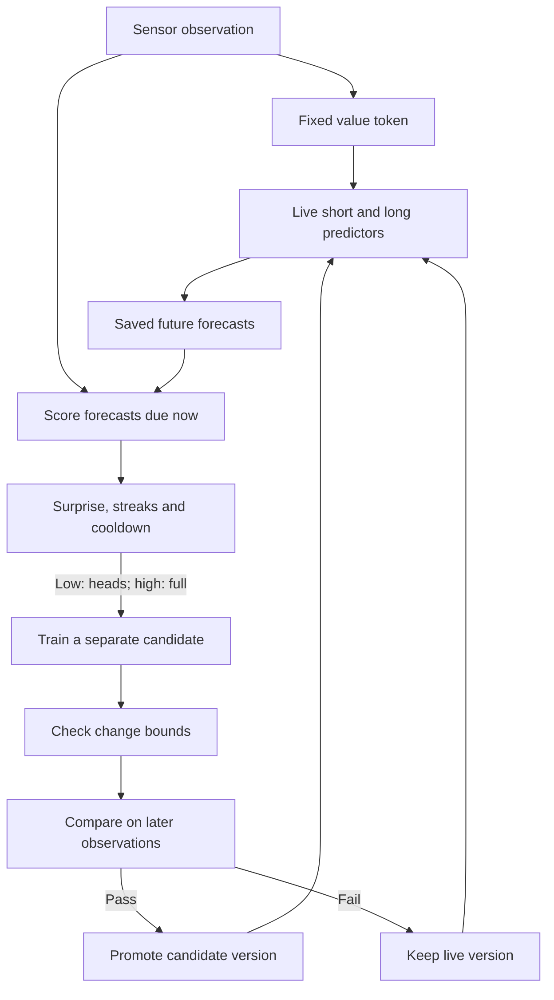
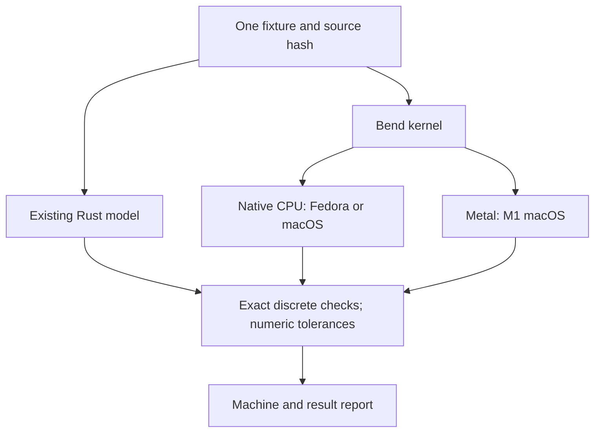

# Rust ↔ Bend: one sensor-learning kernel, three execution lanes

This is the first executable portability experiment for the
[n0m1 sensor-learning example](../sensor_learning/README.md). The existing Rust
model supplies the reference. Bend implements the same two forward passes and
one clipped SGD update. Both consume exactly the same saved weights and features.

The target lanes are Fedora on the Ryzen 7 4700U CPU, macOS on the M1 CPU, and
macOS on the M1 Metal GPU. **A CPU build uses Bend's existing native C backend;
it does not require an AMD GPU port.** The Metal lane provides another runtime
to compare against. An eventual AMD GPU backend would become a fourth lane and
would still need tests on actual AMD hardware.

## Map the system before replacing its parts

The full continual-learning loop already lives in Rust. Its execution order is:



Scoring precedes learning from a target. The deployed model stays live while its
candidate trains and is evaluated. High surprise alone is not a promotion rule:
noise, missing data, and changes that cannot be learned can all be surprising.
The Rust example implements replay, reserved reference data, scope checks,
future evaluation, persistence and the bounded worker.

This directory tests the **numerical kernel boundary**, before replacing that
working loop:



| Component | Implemented here | Boundary |
| --- | --- | --- |
| Binary input | Canonical signed i32, little endian; missing/out-of-range cases | The OS has already decoded the sensor register |
| Value tokenizer | 32 bins over `[0, 128000)` | Fixed codec, no training |
| Short predictor | 40 → 16 tanh → 32 softmax; 1,200 parameters | Predicts the next value token |
| Long predictor | 40 → 4 tanh → four signs → 32 softmax; 324 parameters | Code 0–15; straight-through training approximation |
| Surprise | `-log2(max(p[target], 1e-9))` | Prediction before the corresponding update |
| Learning | One heads-only update and one full update, independently from the same starting model | Rate 0.03; global gradient norm clipped at 1 |
| Discrete policy | Readiness × candidate-busy × severity → hold / heads / full | A proposed contract; EWMA/streak computation remains in Rust |
| Continual learning | Existing Rust engine | Its scheduler, buffers, future validation and checkpoint state are not ported here |

This is a tiny predictive model, not an LLM or a demonstration of learned
language semantics. The four-bit code is a learned predictive bottleneck. This
experiment checks that its computation survives a backend change.

For example, the canonical bytes `[64, 156, 0, 0]` decode to raw value `40000`,
which becomes token `10`. With a uniform 32-way prediction, observing any token
has surprise `5` bits. A separate trainable predictor learns a distribution over
future value tokens; the tokenizer does not need to infer Celsius to do so.

## What the fixture checks

`fixture.json` is committed once and copied unchanged to both machines. Do not
regenerate it separately on each machine. It contains ten sensor cases and eight
model cases: four feature vectors for each network, including a zero vector,
ordinary features, and a large feature that exercises gradient clipping.

Each model case produces three rows: before training, after heads-only training,
and after full training. The two updates start from the same initial model.
There are **24 rows and 19,080 numeric values** per comparison:

- All 1,524 model parameters, across the eight cases and three modes.
- All 32 probabilities, target surprise, argmax, and the long network's code.
- Exact byte decoding, token IDs, and all 12 cases of the abstract policy gate.
- Bit-preserved encoder parameters after heads-only training, valid probability
  distributions, initial-weight identity, and the clipped step bound.

Numerical acceptance is `abs(actual - reference) <= 2e-6 + 2e-5*abs(reference)`.
These are initial test tolerances, not a universal bound on backend error. A
changed argmax or four-bit code fails even if all floats satisfy the tolerance.
NaN, infinity, missing rows, and mismatched source/fixture hashes fail. Every
warmup and measured run is checked, rather than selecting a favorable run.

The Bend implementation uses recursive lists to keep operations inspectable.
Its balanced tree of independent cases and parallel calls expose work to CPU
threads and the GPU. A fast neural implementation may need a different memory
layout. This first version deliberately provides a correctness baseline.

## Run on both machines

Prerequisites: Git, Python 3.10+, Rust 1.99.1 via Cargo, Bun, and Clang. The pinned
Bend source is listed in `toolchain.json`; its checkout must be clean. The
CI Bun version is pinned in the workflow. No global Bend installation is needed.

For Fedora, install `clang`, `python3`, and `git` with DNF. For M1, use a native
arm64 terminal and an installed Xcode command-line toolchain. CPU builds need
Clang 14+. This Bend revision's Metal build needs Apple Clang 17+ or Clang 19+
and a working Metal compiler; an older Xcode installation may need an upgrade.
The runner checks the compiler version before building.

From this directory:

```bash
# Keep this compiler checkout outside the n0m1 repository.
git clone https://github.com/bendlang/bend.git ../../../bend-toolchain
git -C ../../../bend-toolchain checkout --detach b8664b0a7ff36858b353fdbee77e41a3dd3548db

# The runner invokes Cargo; ensure its active toolchain is 1.99.1.
rustup toolchain install 1.99.1 --profile minimal
export RUSTUP_TOOLCHAIN=1.99.1

python3 -m unittest discover -s tests -v
```

On the **4700U**, start with one thread and then eight:

```bash
python3 harness.py run --backend cpu --threads 1 \
  --bend-source ../../../bend-toolchain --out results/4700u-cpu-1.json
python3 harness.py run --backend cpu --threads 8 \
  --bend-source ../../../bend-toolchain --out results/4700u-cpu-8.json
```

On the **M1**, run CPU first, then Metal:

```bash
python3 harness.py run --backend cpu --threads 1 \
  --bend-source ../../../bend-toolchain --out results/m1-cpu-1.json
python3 harness.py run --backend cpu --threads 8 \
  --bend-source ../../../bend-toolchain --out results/m1-cpu-8.json
python3 harness.py run --backend metal --threads 1 \
  --bend-source ../../../bend-toolchain --out results/m1-metal.json
```

`--threads` controls CPU threads, not GPU lanes. Metal uses a separate entry point
with `K.batch!(...)` at the computation feeding an IO step. The runner requires
the native `.gpu` sidecar and explicitly requests a 256 MB GPU heap. In the pinned
runtime an explicit GPU request fails if no GPU is available; default automatic
mode could fall back to CPU. The report records this evidence. It is **not** a
GPU profiler trace; use Instruments Metal System Trace before making detailed
utilization or kernel-performance claims. There is no Metal lane on Fedora and
no AMD GPU lane in this example.

Each command builds the Rust reference, checks the laws, compiles Bend, performs
one warmup plus three checked runs, and saves a report. Generated Bend fixtures,
executables and reports are ignored by Git. `--repetitions N` changes the measured
run count. `--reference PATH` handles a custom Cargo target directory.
`--bend-command '...'` permits an explicit compiler adapter; the command is
recorded in the report, split into literal arguments, and never executed by a
shell.

Copy the reports into one checkout at the same revision, then compare:

```bash
python3 harness.py compare \
  results/4700u-cpu-1.json results/4700u-cpu-8.json \
  results/m1-cpu-1.json results/m1-cpu-8.json results/m1-metal.json
```

The comparison revalidates each report against its Rust reference, then compares
Bend results across machines. It refuses different source hashes, fixture hashes,
or Bend commits. Reports record CPU/OS, compiler versions, runtime arguments,
proof-check mode, numeric differences and raw outputs. They are reproducibility
records, not signed attestations.

Timing currently measures **whole-process wall time**, including startup,
computation, synchronization, output serialization, and capture. Each run exits
only after results reach stdout. This is useful for checking small-workload
costs. It is not a compute-only benchmark or a fair claim of GPU speedup, and
CPU/GPU power consumption is not measured. A later throughput experiment should
add larger independent batches and profiling while preserving these checks.

## What the proofs say

`bend/LAWS.bend` proposes six laws, proved in `bend/PROOF.bend`:

1. Not ready means hold, regardless of busy status or severity.
2. Already busy means hold, regardless of readiness or severity.
3. Calm means hold, regardless of readiness or busy status.
4. Heads-only selection preserves the old encoder for any data type.
5. Hold selection preserves the old encoder for any data type.
6. Ready, idle, and drift severity selects full training.

The numerical kernel calls that same proved `Gate.encoder` selector. This connects
the encoder-preservation law to the code under test. These are laws we proposed
for this example; review their intent before making them authoritative contracts.
They do not prove that readiness/severity was computed correctly, that high
surprise is learnable, that training improves predictions, or that sensor input
is trustworthy. They also do not constitute a proof of the whole Rust controller.

By default the runner performs the Bend source checker pass. To require the
separate Lean-backed BendTT kernel verdict, install **Lean 4.34.0** as required by
the pinned Bend source and add `--verdict` to each `run` command. A missing kernel
or failed verdict stops the run; it is never converted to a successful proof.
You can inspect it separately:

```bash
bun ../../../bend-toolchain/bend2/main.ts bend/PROOF.bend --check-only
bun ../../../bend-toolchain/bend2/main.ts bend/PROOF.bend --verdict
bun ../../../bend-toolchain/bend2/main.ts bend/PROOF.bend -o .build/PROOF.bendtt
```

Bend's F32 operations are axiomatic at this revision. The numerical kernel is
therefore validated by differential tests, not by an arithmetic correctness
proof. A kernel verdict still relies on the translation/parser and does not
verify native compiler output, GPU drivers, foreign IO, or physical hardware.
Agreement between two implementations can also miss a shared specification bug.

## Files and next boundary

| File | Role |
| --- | --- |
| `../sensor_learning/examples/backend_reference.rs` | Export fixture; evaluate it using the existing Rust model |
| `fixture.json` | Common initial weights, features, targets and sensor bytes |
| `bend/kernel.bend` | Forward pass, discrete bottleneck, clipped SGD, balanced case execution |
| `bend/codec.bend` | Canonical bytes to value tokens |
| `bend/gate.bend`, `LAWS.bend`, `PROOF.bend` | Discrete policy and its proofs |
| `bend/emit.bend` | JSON result encoding outside the numeric computation |
| `harness.py` | Fixture generation, build, validation, reports and cross-machine comparison |
| `tests/test_harness.py` | Corruption, tolerance, scope and report-identity rejection tests |
| `VALIDATION.md` | What was actually tested during development |

After all three intended lanes pass, the next port should replay **saved ordered
training jobs** through Bend: identical examples, scopes, rates and checkpoints.
Then compare complete candidate evaluation and promotion decisions on recorded
future readings. Only then integrate a persistent Bend worker with the Rust host.
This revision of Bend emits whole native programs; this example does not assume
a stable Rust/C library-export API. Runtime and checkpoint ownership should stay
explicit at that boundary.

A useful subsequent benchmark adds batched inference, many-step drift, deliberate
near-threshold cases, and live temperature traces. The present suite does not
claim full-trajectory equivalence, general hardware correctness, or a completed
AMD GPU backend.

Sources: the pinned upstream [guide](https://github.com/bendlang/bend/blob/b8664b0a7ff36858b353fdbee77e41a3dd3548db/guide/GUIDE.md),
[CLI build selection](https://github.com/bendlang/bend/blob/b8664b0a7ff36858b353fdbee77e41a3dd3548db/bend2/main.ts),
[runtime GPU selection](https://github.com/bendlang/bend/blob/b8664b0a7ff36858b353fdbee77e41a3dd3548db/bend2/comp.ts),
and [kernel interface](https://github.com/bendlang/bend/blob/b8664b0a7ff36858b353fdbee77e41a3dd3548db/bend2/safe.ts).
