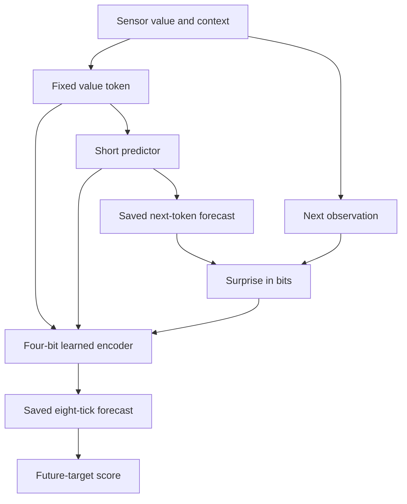
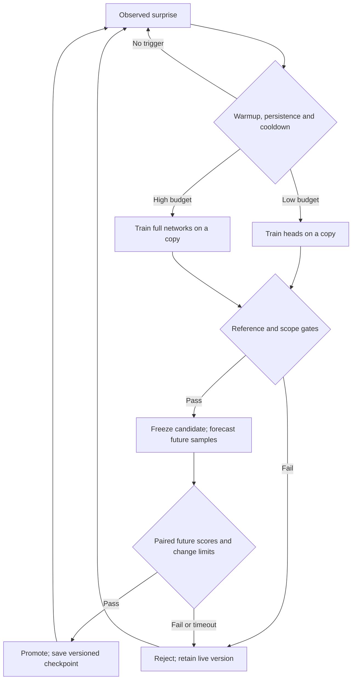

# Sensor tokens and bounded continual learning

A small Rust experiment for n0m1: read a temperature, emit a fixed value token,
predict future tokens, measure surprise, and learn a second discrete code from
the sensor token and the first predictor's output. Train a candidate when needed;
promote it only after checking its scope and its predictions on future samples.

This is a runnable predictive-learning scaffold, not an LLM or a general
intelligence model. The two networks contain **1,524 trainable float32 values**
(6,096 bytes of weights). The program, SQLite, buffers, and temporary candidate
copies use additional memory. No model download, Python runtime, GPU, or ROCm is
required. The mathematics are explicit so the learning loop can be inspected.

## Run the simulator first

From the repository root, on Fedora:

```bash
sudo dnf install rust cargo gcc
cd examples/sensor_learning
cargo test --locked
cargo run --locked --release -- --source simulate --steps 3000 --db simulated.db
```

`Cargo.lock` fixes the dependency resolution. Development and CI use Rust 1.99.1.
A C compiler builds bundled SQLite.
Use a current stable Rust toolchain if your Fedora release's compiler cannot
build a dependency in the lockfile.

Simulation runs as fast as it can, with virtual one-second observations. It has
repeatable load cycles, an ambient-temperature shift, and an occasional missing
sample. Model initialization, training samples, and the simulated input are
seeded. Candidate training is synchronous in simulation so operating-system
scheduling cannot decide when validation starts. Timing fields are still real
wall-clock measurements and will vary.

Progress and candidate decisions go to stderr; a final JSON summary goes to
stdout. To compare with the same initially untrained networks held fixed:

```bash
cargo run --locked --release -- --steps 3000 --no-train --db frozen.db
```

The first/last 256-sample summaries are descriptive: those windows see different
data. The candidate promotion test instead compares two forecasts on the **same
future targets**. A frozen untrained network is only a basic sanity baseline;
compare persistence, transition counts, and stronger predictors before making
claims about the value of neural learning.

The checked 3,000-tick run with seed 7 produced these results (lower is better):

| Mean surprise over all scored targets | Frozen initial models | Continual learning |
| --- | ---: | ---: |
| Next tick | 4.997 bits | 3.846 bits |
| Eight ticks ahead | 4.919 bits | 4.556 bits |

It attempted 32 full-network and 7 heads-only updates, promoted 15 candidates,
and rejected 24. Both runs recorded three simulated missing samples. These are
toy-data results, not evidence of an advantage over conventional time-series
methods or a measured result on the 4700U. Small floating-point differences
across platforms can affect decisions close to a threshold.

## Read the CPU temperature

```bash
cargo run --locked --release -- --list-sensors
cargo run --locked --release -- --source hwmon --steps 600 --db cpu.db
```

Automatic discovery looks for the `k10temp` driver and prefers `Tdie`, then
`Tctl`. It does not assume `hwmon0` or silently choose between multiple matches.
For a different sensor, use an exact path printed by `--list-sensors`:

```bash
cargo run --locked --release -- --source hwmon \
  --sensor /sys/class/hwmon/hwmon3/temp1_input --steps 600 --db cpu.db
```

That path is an example; hardware numbering can change at boot. Inspect the
driver and label on your machine. `Tctl` is a control reading and may differ
from physical die temperature. The program reads sysfs and `/proc/stat` without
root, subject to the machine's file permissions. It does not change fans, CPU
frequency, power limits, kernel settings, or firmware.

The intended first target is Fedora on a Ryzen 7 4700U, using CPU computation at
one observation per second. The simulator and fixtures are portable tests; they
are not a benchmark or verification on that particular laptop. Measure latency,
CPU use, temperature, and battery impact there before leaving it running.

Useful options:

| Option | Meaning |
| --- | --- |
| `--steps 0` | Run until SIGINT or SIGTERM |
| `--interval-ms 1000` | Real-input interval; minimum 100 ms |
| `--max-train-ms 100` | Real-input training time cap per candidate, in addition to the step cap |
| `--no-train` | Score and log using fixed weights |
| `--resume` | Load the latest checkpoint from this database, requiring the same source and configuration |
| `--seed 7` | Simulator seed; part of the checkpoint source identity |

For real input, one worker trains a copy while sampling continues. There is at
most one candidate, including its validation phase, and no accumulating work
queue. The time cap is checked between SGD steps; snapshot copying, gate checks,
and one in-progress step add overhead. This is not a hard real-time guarantee.
CPU load and estimated training activity are recorded as context because
training itself can heat the sensor being predicted.

## What goes from bits to tokens?

Linux hwmon has already decoded the hardware register into a signed integer,
normally millidegrees Celsius. This example serializes that integer into four
little-endian bytes and stores both representations. It does **not** infer an
unknown device's register layout, endianness, units, or clock automatically.
Those belong to the sensor contract—the first part of the harness.

The fixed tokenizer accepts `0 <= raw < 128000` and emits `raw / 4000`, giving
32 token IDs. For example:

| Representation | Value |
| --- | --- |
| Driver-decoded integer | `52000` |
| Canonical bytes, hexadecimal | `20 cb 00 00` |
| Value token | `13` |
| Interval represented by token 13 | `[52000, 56000)` |

The networks use the ID, not the word “Celsius.” The coarse bin size makes this
example easy to inspect; it loses distinctions inside a bin. Raw values remain
in the log. Missing, malformed, or out-of-range values are logged as invalid,
not clamped into apparently valid observations. A gap cancels pending forecasts
and resets the previous-sample context.

The fixed codec ID is recorded in every run and checkpoint. A learned tokenizer
would require its own reconstruction/rate objective, versioning, and migration
rules; allowing it to collapse every input into one token would artificially
reduce surprise while destroying information.

## The two learned layers

| Component | Shape | Trainable values | Output |
| --- | --- | ---: | --- |
| Short predictor | 40 inputs → 16 tanh → 32-way softmax | 1,200 | Distribution of the next value token |
| Longer predictor | 40 inputs → 4 tanh → four signs → 32-way softmax | 324 | Code 0–15 and distribution eight ticks ahead |

The 40 inputs are a 32-way one-hot value token plus eight scalars: normalized
raw value, change from the previous reading, CPU load, elapsed time, training
activity, latest scored short-horizon surprise, the short predictor's argmax
token, and a constant. The short predictor's argmax slot is zero for its own
input; the longer predictor receives the newly computed argmax. Scaling and
clipping are explicit in `engine.rs`. Surprise is a numeric feature rather
than an additional learned token vocabulary.

The longer head receives **only the four quantized signs** of its hidden layer.
There is no continuous bypass. Its four bits form a code from 0 to 15; inputs
with the same code necessarily give the same longer prediction under that
model version. This makes the code a real predictive bottleneck.

Backpropagation uses the straight-through approximation for the signs. The
ordinary continuous network has a finite-difference gradient test; the
discrete sign operation does not have the derivative used by this estimator.
There is no code-usage balancing objective, so some codes may never be used.

Code 7 has no predefined interpretation. Study the raw readings, contexts, and
future outcomes associated with `(run_id, version, code)` before attaching a
human label. Token 13 at the fixed sensor layer keeps its meaning; learned
codes can change when an encoder update is promoted.



At tick `t`, score the forecasts made earlier that target `t`, then construct
the new features and issue forecasts for `t+1` and `t+8`. In each case:

```text
surprise_bits = -log2(saved_probability[observed_token])
```

Probabilities have a `1e-9` floor only in the logarithm, limiting the recorded
penalty to about 29.9 bits. A uniform distribution over 32 tokens gives 5 bits.
Training minimizes categorical cross entropy in natural-log units; reporting
uses bits. No target is scored by recomputing its prediction after training.

## Continual training with bounded changes

Observations and scores update continuously. Weights change only through this
candidate process:



The defaults live in `learning::Config`. They are illustrative controls, not
thresholds established by a scientific calibration study:

| Control | Default |
| --- | --- |
| Initial warmup | 128 scored short forecasts, plus enough training/reference data |
| Fast / slow surprise EWMA factors | 0.15 / 0.005 |
| High trigger | Fast surprise above 3 bits or baseline + 1 bit for 8 scored observations |
| Low trigger | Fast surprise above 0.75 bits or baseline + 0.35 bits for 16 scored observations |
| Minimum spacing of attempts | 64 observation ticks |
| Maintenance attempt | After 256 ticks without an attempt |
| Low / high SGD budget | 96 / 384 steps per network |
| Low / high scope | Output weights and biases / all weights and biases |
| Learning rate / gradient norm cap | 0.03 / 1.0 |
| Training storage per layer | 256 recent examples and 512 reservoir replay examples |
| Reference storage per layer | 64 reserved examples, excluded from both training collections |
| Parameter RMS change limit | 0.12 per network |
| Mean output total-variation limit | 0.45 per layer |
| Learned-code change limit | 25% of compared inputs |
| Allowed predictive regression | 0.20 bits per layer |
| Required mean future gain | At least 0.02 bits, averaging the two layers |
| Minimum fresh validation | 32 scored targets per layer |
| Validation timeout | More than 256 ticks after the candidate is ready |

The initial fitting attempt uses the high budget. Subsequent triggering is a
heuristic based on the short predictor's surprise; the longer predictor is
checked at promotion but does not independently request training. Training
draws half its examples, in expectation, from recent data and half from replay.
Those collections may overlap; reference examples cannot enter either one.
Every eighth forecast origin is assigned to reference storage before its
target arrives. These are temporally correlated observations, not IID samples.

Training checks the reference gate every 16 steps and at the end. If a chunk
exceeds the limits, it retains the last acceptable chunk and stops. The event
log records attempted and retained steps and the stopping reason. A candidate
that retains zero steps cannot pass the required future-gain test.

The reference gate checks shapes and finite values, exact encoder equality for
heads-only updates, RMS parameter displacement, output distribution movement,
code changes, and predictive regression. Passing creates a frozen candidate.
Both versions then forecast identical newly arriving inputs; those future
targets were unavailable to the candidate's training. Promotion requires
bounded distribution/code changes, no layer regressing by more than the limit,
and sufficient average predictive gain. All previous promoted checkpoints
remain in SQLite.

During paired evaluation, both versions consume the live pipeline's same
recorded features. This tests a local model substitution. It does not prove
that a recursively substituted multi-layer pipeline has identical behavior:
after promotion, a changed short predictor can change the longer predictor's
argmax context. A larger deployment should additionally validate full pipeline
rollouts and maintain an automatic rollback policy. This example retains
checkpoints but does not automatically roll back an already promoted model.

High surprise can be noise, a changed environment, a bad sensor, or a poor
model. It authorizes a bounded experiment, never automatic acceptance. The
controller itself is fixed code; it does not yet learn its optimizer or infer
new domains. Strong drift can also cause the conservative gates to reject
every proposal. Inspect that result instead of assuming increased training
will solve it.

## Inspect the record

Five namespaced tables keep this experiment separate from the existing Python
daemon tables: `sensor_runs`, `sensor_readings`, `sensor_predictions`,
`sensor_events`, and `sensor_checkpoints`. The default database is separate.

Install the SQLite CLI if desired (`sudo dnf install sqlite`). Examples:

```sql
-- Mean pre-update predictive surprise, by layer and issued model version.
SELECT run_id, layer, version, count(*) AS scored,
       round(avg(surprise_bits), 3) AS bits
FROM sensor_predictions
WHERE actual IS NOT NULL
GROUP BY run_id, layer, version;

-- What changed, and why was each candidate accepted or rejected?
SELECT step, kind, detail
FROM sensor_events
WHERE run_id = (SELECT max(id) FROM sensor_runs)
ORDER BY id;

-- Associate higher-layer codes with sensor readings; do not pool versions.
SELECT p.run_id, p.version, p.code, count(*) AS uses,
       round(avg(r.raw_millic)) AS mean_raw
FROM sensor_predictions p
JOIN sensor_readings r ON r.run_id=p.run_id AND r.step=p.origin
WHERE p.layer=1
GROUP BY p.run_id, p.version, p.code;
```

`layer=0` is the short predictor and `layer=1` is the longer predictor.
Predictions record issue/target ticks, the live model version, both live and
candidate probability vectors before their targets arrive, optional code,
actual target, surprise, and paired candidate score.
Unreadable samples and cancelled forecasts remain visible. A run completes
normally on SIGINT/SIGTERM; an abrupt crash can leave `completed=0` and pending
forecasts. Resume starts a new run from the latest compatible promoted weights,
with fresh buffers, warmup, and pending queues. It is not an exact process-state
continuation or a resume of simulator time. Sensor-path changes require a new
source identity/database or an explicitly implemented migration.

Training buffers and candidate work are bounded. **Database history is not**:
rotate or archive databases for unattended operation. SQLite write failures
stop the process rather than silently dropping the audit record. WAL mode
allows readers alongside the single writer; disk latency can still affect
sampling intervals. A successful observation batch commits its readings,
scores, new forecasts, and any promoted checkpoint together. Events are
committed separately and can lag that transaction if the process crashes.

## Run as a user service

Build the release binary, then install the example unit:

```bash
install -Dm755 target/release/n0m1-sensorlab ~/.local/bin/n0m1-sensorlab
mkdir -p ~/.local/state/n0m1-sensorlab ~/.config/systemd/user
cp n0m1-sensorlab.service ~/.config/systemd/user/
systemctl --user daemon-reload
systemctl --user start n0m1-sensorlab
journalctl --user -u n0m1-sensorlab -f
```

Review the unit before using `systemctl --user enable n0m1-sensorlab`. It uses
automatic CPU sensor selection, runs at 1 Hz, and has a CPU quota and memory
limit. It starts fresh weights on restart while retaining previous runs. Add
`--resume` only after creating a compatible checkpoint. `systemctl --user stop
n0m1-sensorlab` sends SIGTERM for graceful shutdown. User-service resource
control depends on the system's cgroup configuration.

## Code map and next experiments

| File | Responsibility |
| --- | --- |
| `src/sensor.rs` | Framing, fixed tokenizer, simulator, hwmon discovery, CPU load |
| `src/model.rs` | Forward pass, quantized bottleneck, clipped SGD |
| `src/learning.rs` | Replay/reference split, controller, candidate training and reference gates |
| `src/engine.rs` | Causal forecasts, surprise, paired future validation, promotion |
| `src/store.rs` | SQLite records and compatible checkpoints |
| `src/main.rs` | CLI, sampling, one bounded worker, signals |

Run `cargo fmt --all -- --check`, `cargo clippy --locked --all-targets -- -D warnings`,
and `cargo test --locked`. The tests check causal scoring, invalid gaps, actual
gradients, scope limits, discrete-code behavior, disjoint holdouts, discovery,
checkpoint compatibility, SQLite records, and learning on the deterministic
simulator.

For n0m1 integration, first consume these tables as an additional source in a
nano instance, carrying source, codec, model version, horizon, and surprise with
each code. Keep the raw observations available for grounding. The current
example does not modify the Python managers or wire itself into their startup.

The next useful comparison is fixed bins versus a learned codec with an
explicit reconstruction/rate penalty, and tiny neural predictors versus
transition-count or persistence baselines on held-out recordings. Then test
multiple sensor domains, missing channels, calibrated uncertainty, and a
controller that allocates compute based on measured learning progress. A
larger model can move to a Rust autodiff framework such as Burn while retaining
the forecast ledger and candidate gates. A language model could consume the
versioned sensor codes through an explicit adapter or learned embeddings;
arbitrary IDs do not acquire language meaning automatically.

## References

- [Linux hwmon sysfs interface](https://docs.kernel.org/hwmon/sysfs-interface.html)
- [Linux k10temp driver](https://docs.kernel.org/hwmon/k10temp.html)
- [Fedora Rust installation](https://developer.fedoraproject.org/tech/languages/rust/rust-installation.html)
- [Neural Discrete Representation Learning](https://arxiv.org/abs/1711.00937): discrete learned representations; this example is not a VQ-VAE implementation.
- [Finite Scalar Quantization](https://arxiv.org/abs/2309.15505): related quantization ideas; this four-sign toy bottleneck is not a reproduction of the paper.
- [Burn](https://github.com/tracel-ai/burn): possible future tensor/autodiff backend.

## Compare the kernel with Bend

The [backend comparison example](../backend_comparison/README.md) replays shared
weights and features through this Rust model and a Bend port. It checks fixed
predictions and one heads-only/full update, provides discrete policy laws, and
includes CPU and M1 Metal runners. It is the first portability milestone; the
continual-learning engine remains here.
